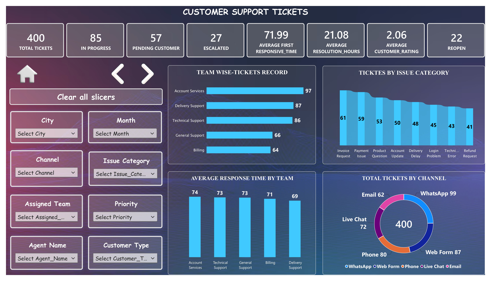
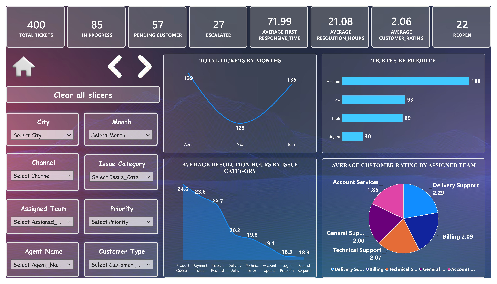
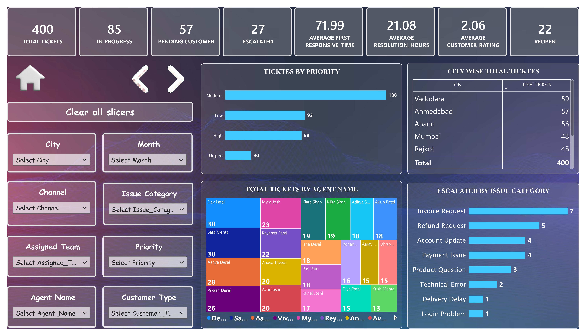
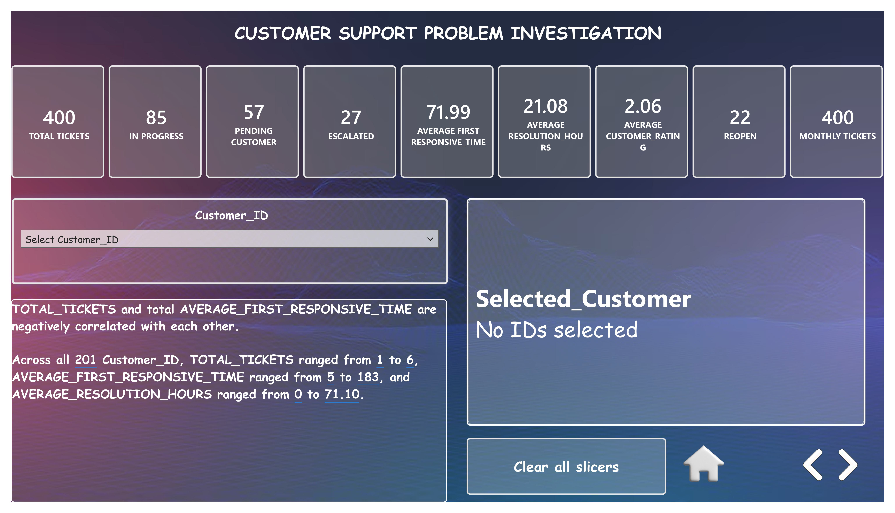

# Customer Support Ticket Dashboard

A Power BI dashboard project that analyzes customer support tickets
to understand ticket trends, team performance, and customer satisfaction.

## Project Overview

This project uses customer support ticket data to identify patterns
in ticket volume, response time, resolution time, and customer ratings.

## Dashboard Preview

### Page 1: Ticket Overview

### Page 2: Ticket Analysis

### Page 3: Agent and City Analysis

### Page 4: Problem Investigation

## Key Features

- Total tickets and ticket status analysis
- Team-wise and issue category analysis
- Average response and resolution time
- Priority and channel analysis
- Agent performance and city-wise analysis
- Customer satisfaction and reopened tickets
- Interactive slicers for filtering data

## Tools Used

- Microsoft Power BI
- Power Query
- DAX
- Microsoft Excel

## Project Files

- `DOCUMENTATION.md` — Detailed project documentation
- `dashboard/` — Dashboard page screenshots
- `powerbi/` — Power BI project file

## Author

**Pankti Ladava**

